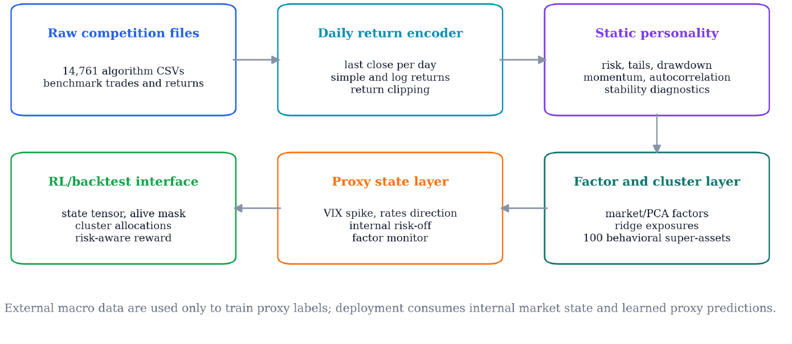
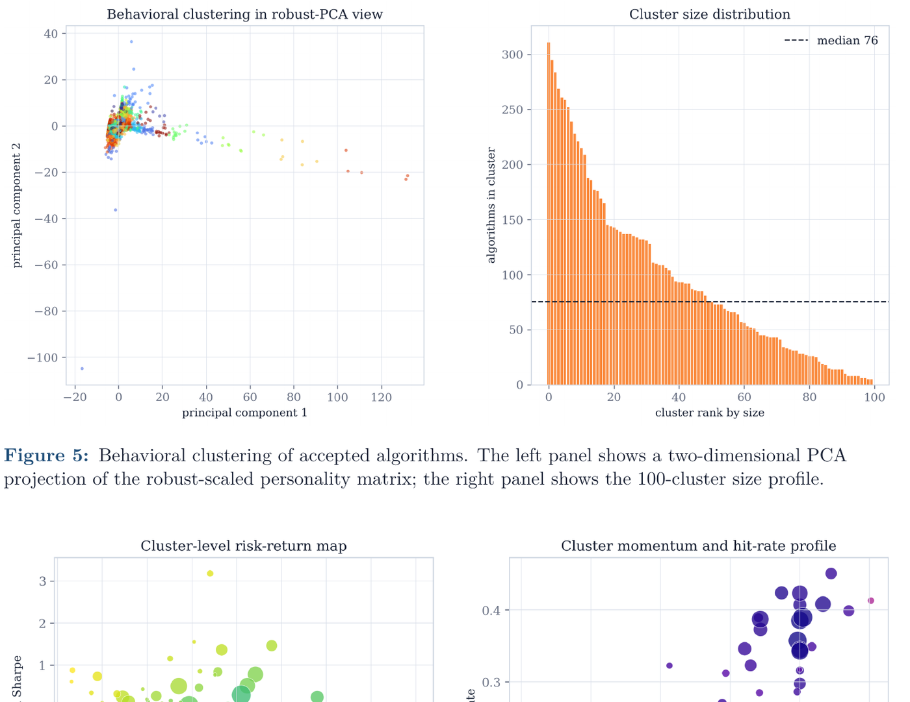
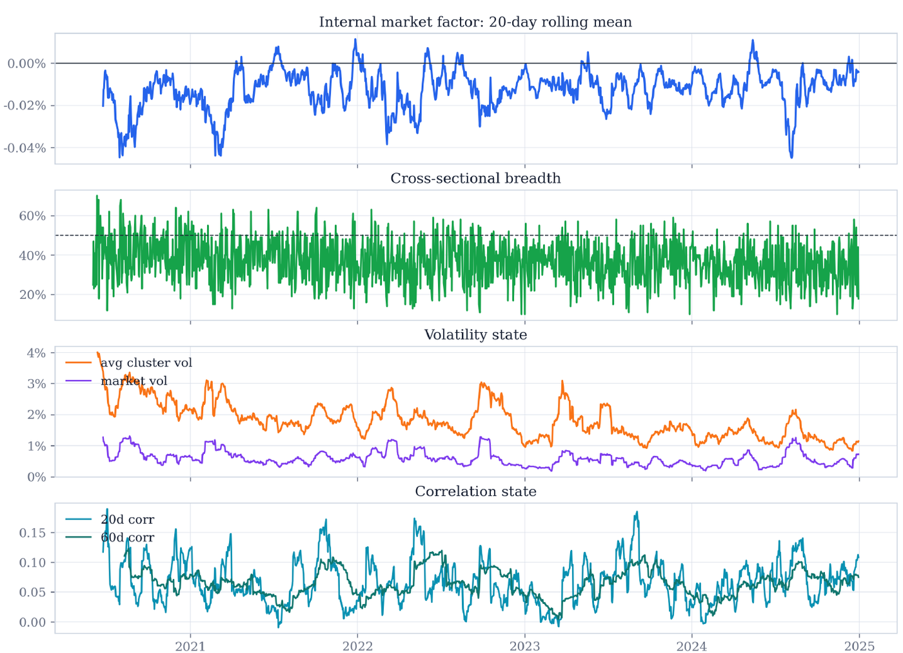
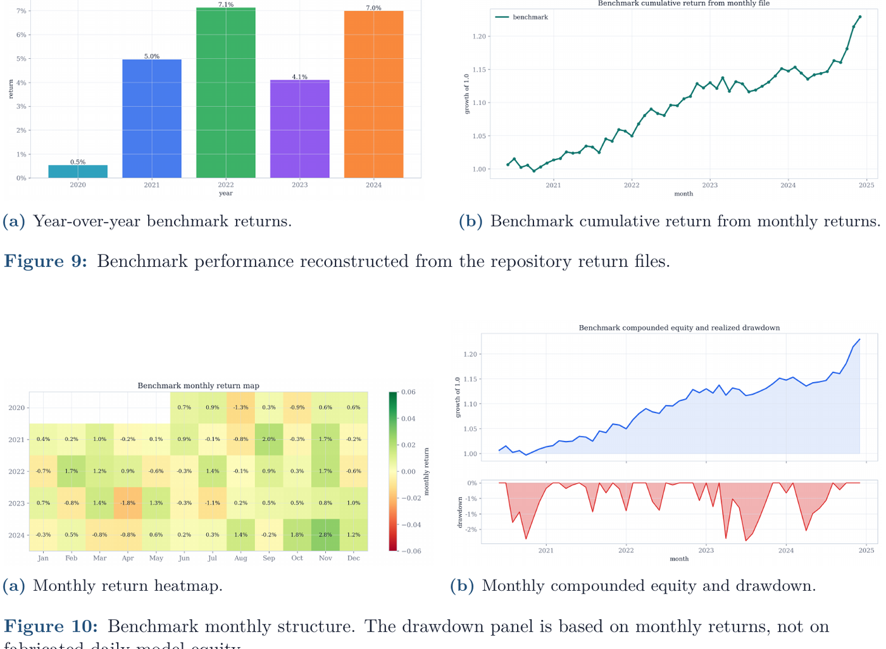

La versione allettante di un progetto di RL finanziario per una competizione è saltare subito all'agente. Scegli PPO, definisci uno spazio delle azioni, addestri una policy, disegni una bella curva di equity. Il progetto AthenAI mi ha spinto nella direzione opposta.

La parte difficile non era la sigla dopo la parola "agente". La parte difficile era costruire una rappresentazione dello stato da cui un agente potesse imparare in modo onesto.

Ho affrontato la sfida meno come "me ne intendo di finanza" e più come un problema di apprendimento delle rappresentazioni con regole sul leakage insolitamente severe. Ogni idea attraente doveva superare un test semplice: questo segnale potrebbe esistere al momento della decisione, e codifica per sbaglio la performance futura? Se la risposta non era chiara, la feature doveva scendere a diagnostica o a lavoro futuro.

L'universo grezzo conteneva migliaia di file di algoritmi di trading proprietari, ognuno con righe OHLC intraday. C'era anche un file di operazioni del benchmark. Un'impostazione di RL ingenua tratterebbe ogni algoritmo come un asset e chiederebbe a un modello di allocare direttamente tra tutti. È fragile per tre motivi:

- Molte serie di algoritmi sono brevi, sparse, costanti o rotte.
- L'universo non è stazionario.
- Il deployment non dovrebbe dipendere da API macroeconomiche in tempo reale, anche se le etichette macro sono utili in addestramento.

Così il progetto è diventato una pipeline offline a strati:

```text
CSV grezzi degli algoritmi
  -> ricostruzione delle chiusure giornaliere
  -> filtro di qualità
  -> codifica di rendimenti e operazioni
  -> feature di personalità
  -> clustering comportamentale
  -> serie temporali per cluster
  -> feature di stato su finestre mobili
  -> strati di proxy macro
  -> interfaccia RL/backtesting
```

È meno spettacolare di "ho addestrato un bot di trading". Ed è anche più onesto.



## La competizione come problema di portafoglio offline

L'impostazione formale era un problema sequenziale di gestione del portafoglio. A ogni data di decisione il sistema osserva lo stato attuale dell'universo di algoritmi e sceglie un'allocazione del capitale. La ricompensa arriva dopo, attraverso i rendimenti del portafoglio, corretti per rischio e costi.

In notazione, un'azione di portafoglio si può scrivere come un vettore su C unità investibili:

```text
w_t in simplex(C)
sum_c w_t,c = 1
w_t,c >= 0
```

Il modello mentale utile è un MDP vincolato, con la differenza che lo stato viene ricostruito offline e lo spazio delle azioni è un universo compresso di cluster:

```text
s_t = [cluster_features_t, proxy_scores_t, alive_mask_t, w_t-1]
a_t = w_t

r_t+1 =
  dot(w_t, R_t+1)
  - cost_rate * ||w_t - w_t-1||_1
  - risk_penalty * max(0, drawdown_t+1 - drawdown_limit)
```

Quell'ultimo termine non voleva essere la funzione di ricompensa definitiva da produzione. Era un promemoria di design: nel RL di portafoglio l'agente va penalizzato per percorsi di equity fragili, non solo premiato per i rendimenti puntuali.

Ma l'universo originale aveva troppi algoritmi grezzi perché quello fosse uno spazio delle azioni pulito. La scelta di design centrale è stata comprimere il comportamento degli algoritmi in "superasset" a livello di cluster prima di tentare il RL.

Il report è attento al perimetro: lo strato finale di RL è stato sviluppato come interfaccia DQN/backtesting, non come risultato PPO completo da produzione. PPO e SAC sono buoni candidati futuri per l'allocazione continua, ma l'artefatto attuale è soprattutto la ricostruzione dei dati, la costruzione dello stato, il clustering, la modellazione dei proxy e l'impalcatura per il RL.

## Ricostruire il pannello giornaliero

Ogni file di algoritmo conserva righe OHLC intraday con timestamp e prezzi di chiusura. Il primo passo è stato ridurre ogni algoritmo a una chiusura giornaliera:

```text
P_i,t = ultima chiusura osservata per l'algoritmo i nel giorno t
```

Da lì il sistema calcolava rendimenti giornalieri semplici e logaritmici:

```text
r_i,t = clip(P_i,t / P_i,t-1 - 1, -0.50, 0.50)
l_i,t = clip(log(P_i,t) - log(P_i,t-1), -0.50, 0.50)
```

La soglia di clipping è ampia per scelta. Non serve a sopprimere la normale variazione di una strategia. Impedisce che salti di chiusura rotti dominino le statistiche mobili, la PCA e il clustering basato sulle distanze.

Nell'analisi rigenerata documentata nel report, la pipeline ha letto 14,761 file di algoritmi e prodotto 8,879,120 righe giornaliere. Dei 13,663 identificativi con righe utilizzabili, 9,491 hanno superato il filtro di qualità. Quell'insieme accettato rappresentava circa il 69.5% degli algoritmi osservati, con una mediana di 639 osservazioni giornaliere e una copertura di calendario mediana dell'84.6%.

Questi numeri sono il primo risultato importante. Prima che ci sia un modello, c'è un universo ricostruito.

## Il filtro di qualità evitava il leakage di performance

Il filtro di qualità non selezionava gli algoritmi "buoni". Selezionava serie temporali utilizzabili.

Un algoritmo passava se aveva abbastanza osservazioni, abbastanza copertura di calendario, più di due valori di chiusura distinti e una volatilità dei rendimenti non trascurabile:

```text
accettato se:
  n_i >= 60
  coverage_i >= 0.70
  unique_closes_i > 2
  std(return_i) > 1e-9
```

È un tipo di prudenza importante. Filtrare per Sharpe, rendimento o drawdown in questa fase avrebbe fatto filtrare la performance ex post in ogni risultato a valle. Il filtro eliminava solo le serie troppo brevi, troppo sparse o di fatto costanti.

La distribuzione dei rendimenti giornalieri accettati aveva comunque un grande picco intorno allo zero e code spesse, che è quello che mi aspetterei da curve di strategie: molti algoritmi fanno poco in un dato giorno, mentre un gruppo più piccolo fa movimenti discreti. Il report indica per l'universo accettato un rendimento giornaliero medio di circa -0.008%, una deviazione standard dello 0.493% e quantili 1%/99% di -1.67% e 1.53%.

## Il benchmark era una traccia, non un oracolo

Il file del benchmark conteneva 5,394 operazioni su 271 algoritmi distinti, con un periodo di detenzione mediano di 26 giorni di calendario. Includeva nome del prodotto, volume con segno, data di apertura, data di chiusura, importo investito, AUM e campi di equity a fine giornata.

L'ho codificato come traccia di posizioni:

```text
h_i,t = somma dei volumi con segno delle operazioni aperte sull'algoritmo i al tempo t
w_i,t = h_i,t / (epsilon + sum_k abs(h_k,t))
```

È utile per analisi forensi e controlli di coerenza. Mostra dove si è mosso il benchmark nell'universo di algoritmi. Ma non va trattato come l'etichetta di una policy ottimale. Il benchmark operava solo su 271 algoritmi di un universo molto più grande, e le aperture erano concentrate nell'ultima parte del campione. Questo lo rende informativo, ma rischioso come unico obiettivo di imitation learning.

## Feature di personalità degli algoritmi

L'idea di modellazione principale era che gli algoritmi non dovessero essere colonne anonime. Ognuno ha un profilo di comportamento: volatilità, forma del drawdown, rischio di coda, autocorrelazione, momentum e stabilità. L'ho chiamata la sua personalità statica.

Per ogni algoritmo accettato la pipeline calcolava feature come:

- Rendimento medio e deviazione standard.
- Volatilità annualizzata.
- Rapporti di Sharpe e Sortino.
- Quantili empirici e rapporti tra le code.
- Asimmetria e curtosi in eccesso.
- Drawdown massimo e ulcer index.
- Profondità media del drawdown e tempo passato in drawdown.
- Autocorrelazione dei rendimenti a un giorno.
- Autocorrelazione dei rendimenti in valore assoluto.
- Momentum logaritmico a 120 giorni.
- Diagnostica di stabilità tra la prima e la seconda metà del campione.

Le formule note sono semplici ma utili:

```text
Sharpe_i  = sqrt(252) * mean(r_i) / std(r_i)
Sortino_i = sqrt(252) * mean(r_i) / downside_std(r_i)

drawdown_i,t = P_i,t / max_previous_price_i,t - 1
max_drawdown_i = min_t drawdown_i,t
```

Questo vettore di feature dava un significato economico allo strato di clustering. Due algoritmi possono avere lo stesso rendimento medio ma comportamenti completamente diversi nelle code, nella persistenza del drawdown e nell'esposizione a fattori comuni.

## Fattori interni ed esposizioni

La pipeline costruiva anche feature di fattori interni. Il più semplice è il fattore di mercato dell'universo di algoritmi:

```text
market_factor_t = rendimento medio degli algoritmi vivi al tempo t
```

Calcolava anche fattori PCA su una matrice di rendimenti standardizzata. Ogni algoritmo riceveva poi esposizioni stimate con regressione ridge al mercato interno e ai fattori PCA. Lo scopo non era creare un modello fattoriale perfetto, ma aggiungere informazione di co-movimento al vettore di personalità statica.

L'input del clustering era più o meno:

```text
algorithm_vector_i =
  [personality_i, factor_exposures_i, R2_i, residual_volatility_i]
```

I vettori venivano scalati in modo robusto con mediana e scarto interquartile, e poi raggruppati.

## Cluster comportamentali come superasset

La configurazione di clustering principale nel report era behavioral_k100_v1: 100 cluster appresi dalle feature di personalità e dalla diagnostica fattoriale, scalate in modo robusto. Il progetto implementava anche una famiglia di cluster basata su embedding di correlazione/PCA, ma la configurazione comportamentale a 100 cluster era la compressione principale a valle.

I rendimenti per cluster si costruivano facendo la media dei rendimenti degli algoritmi vivi in ogni cluster:

```text
R_c,t = rendimento medio degli algoritmi assegnati al cluster c e vivi al tempo t
alive_ratio_c,t = algoritmi vivi nel cluster c al tempo t / algoritmi totali nel cluster c
```

È qui che il problema di apprendimento cambiava. Invece di chiedere a un modello di capire direttamente circa 9.5k serie di algoritmi accettati, lo stato ora aveva 100 superasset coerenti nel comportamento, ognuno con metadati, feature mobili e maschere di attività.

Quella compressione non è estetica. È il contributo principale dell'implementazione.



La figura del clustering è la parte del progetto che mostrerei per prima in un colloquio. Dice più di "ho usato k-means". La vista PCA verifica se gli algoritmi accettati hanno outlier evidenti e una struttura di co-movimento. La distribuzione delle dimensioni verifica se la compressione ha prodotto pochi cluster giganti e molti minuscoli. I pannelli di rischio-rendimento e hit rate danno ai cluster una consistenza comportamentale che uno stato di RL può davvero usare. I cluster non sono etichette per una dashboard; sono il nuovo vocabolario dello spazio delle azioni.

## Feature di stato su finestre

Lo strato di stato usava più orizzonti, perché il mercato non si muove a una sola velocità:

- 5 e 10 giorni per la reazione a breve termine e i salti.
- 20 giorni per una vista da mese di borsa e la volatilità realizzata.
- 60 giorni per proxy trimestrali di Sharpe e drawdown.
- 120 giorni per il momentum più lento nello strato di personalità.

Dai rendimenti per cluster la pipeline calcolava feature a livello di universo come ampiezza, dispersione, code, volatilità mobile, correlazioni mobili, propensione ai salti e proxy di drawdown.

Per esempio:

```text
breadth_t = frazione di cluster con rendimento positivo in t
dispersion_t = deviazione standard trasversale dei rendimenti dei cluster in t
```

Questo conta perché i regimi di stress si manifestano spesso come schemi congiunti: ampiezza in calo, correlazione in aumento, volatilità più alta, code sinistre più spesse. Un singolo rendimento aggregato non può catturare quella struttura.



Questo grafico è proprio il motivo per cui non volevo uno stato fatto solo dei rendimenti recenti del portafoglio. Fattore di mercato, ampiezza, volatilità e correlazione si muovono con ritmi diversi. L'ampiezza è rumorosa ma dà la partecipazione trasversale. La volatilità si raggruppa. Le correlazioni hanno picchi e poi decadono. Un agente di portafoglio dovrebbe vedere queste differenze, perché implicano costi diversi per le azioni: a volte la risposta giusta è ridurre il turnover, a volte ruotare tra cluster, a volte semplicemente non fidarsi dello strato di proxy.

## Proxy macro senza dipendere da dati macro in tempo reale

Il vincolo della competizione rendeva delicati i dati macro esterni. VIX, rendimenti dei Treasury e rendimenti dei fattori sono un contesto prezioso in addestramento, ma dipendere da API esterne in tempo reale al momento del deployment avrebbe indebolito il design offline.

Il compromesso è stato uno strato di proxy:

```text
in addestramento:
  scarica i dati macro/fattoriali esterni
  crea i target
  addestra modelli proxy interni dalle feature dell'universo di algoritmi

in previsione:
  usa solo feature interne e modelli proxy addestrati
```

Il report documenta diversi strati di proxy.

Il **proxy dei picchi del VIX** cercava di prevedere grandi variazioni future del log VIX. La sua AUC era intorno a 0.50 +/- 0.10, in pratica come la baseline. La calibrazione ha migliorato l'expected calibration error da 0.036 a 0.0007, ma il segnale di classificazione era debole.

Il **proxy della direzione dei tassi** prevedeva se il rendimento del Treasury a 10 anni sarebbe sceso, rimasto neutro o salito su un orizzonte di 10 giorni. Era il proxy più forte, con un'accuratezza sul segno documentata dell'80.6% +/- 10.8% e una diagnostica di leakage con target rimescolati che separava target reali e permutati.

Il **proxy interno di risk-off** usava il rendimento minimo futuro a 10 giorni del fattore di mercato dei cluster e marcava come risk-off il decile inferiore. Nel target rigenerato la soglia era -0.301% e il tasso di positivi il 9.93%. L'AUC del modello attuale era intorno a 0.46 +/- 0.10, quindi la definizione del target era utile, ma il predittore non era ancora forte.

Il **monitor dei fattori** aggregava mensilmente le feature dell'universo e cercava di prevedere il segno di fattori in stile Fama-French, soprattutto il momentum. Con solo 54 osservazioni mensili, è stato trattato come uno strato diagnostico e di lavoro futuro più che come un segnale forte da produzione.

È in questa sezione che secondo me il report è più solido: riporta risultati negativi. Lo scopo non era fingere che ogni proxy funzionasse. Era capire quali concetti macro l'universo interno riesce oggi a ricostruire e quali no.

## L'interfaccia di RL

Dopo il clustering e la costruzione dei proxy, lo stato di decisione si può scrivere così:

```text
s_t = [
  feature mobili dei cluster,
  stato interno dell'universo,
  punteggi/probabilità dei proxy,
  maschera degli algoritmi vivi,
  allocazione precedente
]
```

L'allocazione precedente conta perché i costi di transazione dipendono dal turnover:

```text
portfolio_return_t+1 =
  dot(w_t, cluster_returns_t+1)
  - cost_rate * L1_norm(w_t - w_t-1)
```

Il backtest segue poi l'equity:

```text
E_t+1 = E_t * (1 + portfolio_return_t+1)
```

e riporta metriche come Sharpe, drawdown massimo, percentuale di periodi positivi e rapporto di Calmar.

Il repository attuale include l'impalcatura per DQN: replay buffer, rete target, selezione delle azioni epsilon-greedy, loss Smooth L1 e strumenti di backtesting. Poiché DQN lavora con azioni discrete, il simplesso continuo del portafoglio andrebbe discretizzato in azioni come mantenere l'allocazione precedente, spostare peso verso un cluster scelto, passare alla liquidità o scegliere tra panieri di cluster predefiniti.

Per una futura versione ad allocazione continua avrebbero senso PPO o SAC. Ma il report non dichiara prestazioni PPO concluse, e non dovrebbe farlo nemmeno questo articolo.

## Cosa ha mostrato il benchmark

Il file dei rendimenti annuali del benchmark mostrava rendimenti positivi in ogni anno disponibile. L'anno migliore è stato il 2022 con il 7.13%, seguito dal 2024 con il 6.99%. Il più debole è stato il 2020 con lo 0.54%, con l'avvertenza che il file mensile comincia a giugno 2020. Componendo il file dei rendimenti mensili si ottiene un rendimento totale del 22.95%, con un drawdown massimo a risoluzione mensile del -1.87%.



Quel drawdown va letto con attenzione. Si basa sui rendimenti mensili del benchmark, non su un'equity infra-mensile inventata. Di nuovo, il tema è la prudenza: riportare quello che i dati sostengono e non riempire con l'immaginazione la risoluzione che manca.

## Cosa ha ottenuto davvero il progetto

Il sistema finale non era una policy di trading finita. Era una pipeline di stato e modellazione costruita in modo verificabile:

- Ha ricostruito un grande universo di algoritmi in un pannello giornaliero.
- Ha filtrato gli algoritmi per affidabilità e non per performance ex post.
- Ha codificato le operazioni del benchmark come traccia di azioni.
- Ha costruito feature di personalità statica per ogni algoritmo accettato.
- Ha compresso circa 9.5k algoritmi accettati in 100 cluster comportamentali.
- Ha costruito rendimenti per cluster, maschere di attività e feature mobili.
- Ha addestrato e valutato strati di proxy macro con controlli espliciti sul leakage.
- Ha esposto lo stato risultante a un'interfaccia DQN/backtesting.

L'osservazione più importante è stata che il clustering cambiava il problema di apprendimento. Invece di presentare a un agente di RL migliaia di colonne di algoritmi sparse e rumorose, il modello riceve un insieme più piccolo di serie temporali coerenti nel comportamento, con metadati interpretabili.

## La lezione

Molto lavoro di ML applicato si vince o si perde prima che il modello si addestri. Questo progetto ne è un buon esempio. Le decisioni interessanti non erano solo nell'algoritmo di RL; erano nella rappresentazione:

```text
Che cos'è un asset?
Che cosa conta come vivo?
Quali filtri fanno trapelare la performance?
Quali segnali macro sono ammessi in deployment?
Che cosa deve vedere lo spazio delle azioni?
Come si riportano onestamente i risultati non supportati?
```

La pipeline di AthenAI mi ha insegnato che un sistema offline di RL finanziario va costruito come una catena di prove. Ogni trasformazione ha bisogno di una ragione, ogni target di una storia sul leakage, e ogni affermazione finale va limitata a quello che gli artefatti rigenerati sostengono.

È questo tipo di prudenza a rendere un progetto di competizione più utile anche dopo che la competizione è finita.
