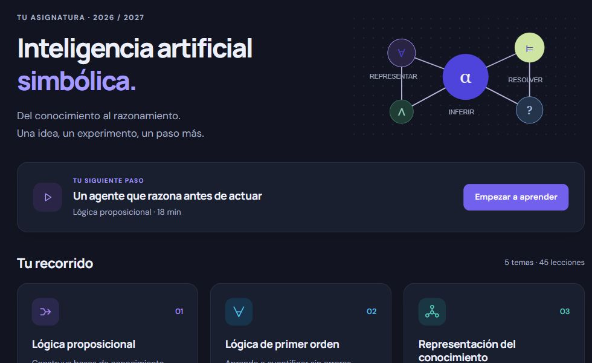

C'è una grande differenza tra leggere la spiegazione di un algoritmo e riuscire a seguire una delle sue decisioni. È quella distanza che volevo che Atlas aiutasse a colmare.

La piattaforma riunisce teoria, esempi svolti, laboratori interattivi e pratica guidata in un unico percorso. Oggi copre IA simbolica, deep learning e IA generativa, in inglese e spagnolo. Il primo dato di adozione è modesto: **più di 30 utenti unici**, secondo il conteggio che ho oggi. Lo prendo come un motivo per continuare ad ascoltare, non come la prova definitiva che il prodotto funziona.



## Un percorso di apprendimento, non una cartella di documenti

Ogni lezione segue quattro fasi: **Capire, Esplorare, Risolvere, Verificare**. La distinzione conta perché ogni fase chiede di fare qualcosa di diverso.

Una spiegazione introduce il concetto e un esempio svolto rende concreto il ragionamento. Un laboratorio permette poi di cambiare un input e di ispezionare gli stati che ne risultano. La pratica aggiunge suggerimenti progressivi e una soluzione ragionata. Le domande spiegate e l'autovalutazione offrono un altro modo per verificare di aver capito.

Non è un sistema di correzione automatica delle risposte libere. Le risposte scritte sono bozze da confrontare con soluzioni ragionate. L'interfaccia deve renderlo chiaro, invece di far credere che aver completato una fase dimostri padronanza.

## Gli esperimenti hanno bisogno di motori veri

Una simulazione deve essere più di un'animazione con un nome convincente. Quando chi impara cambia un input, il processo numerico o logico deve cambiare con lui. Gli stati intermedi devono essere ispezionabili e i limiti dell'esperimento devono essere espliciti.

In Atlas i motori di simulazione specifici di ogni materia sono isolati dagli strati comuni di account e contenuti. Questa separazione permette di testare un calcolo indipendentemente dall'interfaccia che lo mostra. Evita anche che un nuovo corso diventi una nuova applicazione, con la propria autenticazione e la propria logica dei progressi.

L'architettura è volutamente modulare:

```text
manifest del corso + contenuti bilingui delle lezioni
  -> viste di apprendimento comuni
  -> motore di simulazione isolato e adattatore visivo
  -> progressi e preferenze legati all'account
```

Il catalogo attuale contiene **157 lezioni e 26 laboratori interattivi**. Sono una fotografia dei contenuti, non la promessa che ogni argomento immaginabile sia già coperto.

## Una piattaforma, non un'app per materia

La struttura comune gestisce navigazione, preferenze di lingua, profili, feedback e componenti di apprendimento. I corsi gestiscono il proprio programma. I plugin di simulazione gestiscono i calcoli scientifici di cui hanno bisogno.

Questo crea un vincolo utile: aggiungere una materia deve riusare la piattaforma esistente, non introdurre un altro insieme di impostazioni, suggerimenti, menu o profili. Identità stabili per le lezioni conservano i progressi quando i contenuti evolvono. Spagnolo e inglese devono coincidere su identità e significato numerico anche quando la prosa è diversa.

## Salvare fa parte del prodotto

L'accesso con Google crea o recupera un profilo privato nel cloud. Supabase fornisce l'autenticazione e lo strato dei profili su database; a determinare a chi appartiene un profilo è l'identità verificata dell'account, non un nome visualizzato né la cache del browser.

Lingua, preferenze, bozze e progressi appartengono a quell'account. La persistenza nel browser fa da cache interna. La parte difficile della sincronizzazione non è mostrare un'icona di salvataggio: è conservare il lavoro in sospeso e rendere comprensibili errori e cambi di sessione.

Volevo che l'esperienza normale di apprendimento evitasse una serie di decisioni tra salvataggio locale e cloud. Chi impara deve poter tornare al proprio lavoro senza dover capire l'implementazione che c'è sotto.

## Imparare dall'uso senza raccogliere l'apprendimento stesso

La telemetria d'uso e il feedback volontario hanno scopi diversi. Eventi minimi possono aiutare a capire dove si usa il prodotto; una segnalazione volontaria può spiegare dove una lezione o un'interazione va migliorata.

La pipeline di analisi usa Supabase Edge Functions e PostgreSQL. Le identità usate nelle analisi sono separate dalla proprietà dell'account. Nomi, foto del profilo, risposte scritte, bozze e credenziali non hanno posto in quegli eventi. Contano anche le preferenze di opt-out già espresse e il Global Privacy Control. Una preferenza predefinita non dovrebbe mai essere presentata come consenso esplicito.

## La prossima domanda utile

Atlas è online, ma i primi utenti non ne fanno un prodotto finito. La domanda che mi interessa è se l'esperienza di apprendimento è chiara, se gli esperimenti aiutano qualcuno a ragionare e dove la piattaforma intralcia.

È questo il lavoro che voglio continuare a documentare: decisioni concrete, cosa fa davvero l'implementazione e cosa cambia dopo che le persone la usano.

[Apri Atlas](https://atlaslearning.es/)
