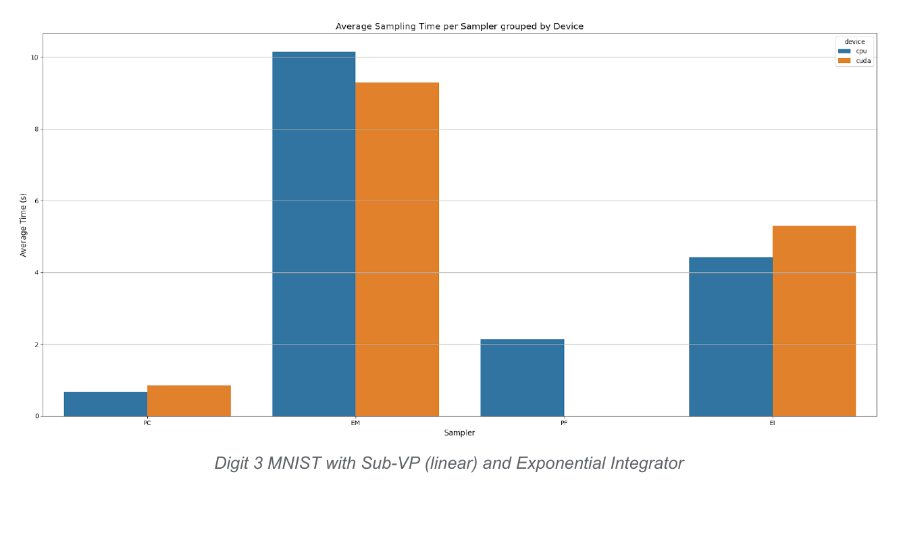
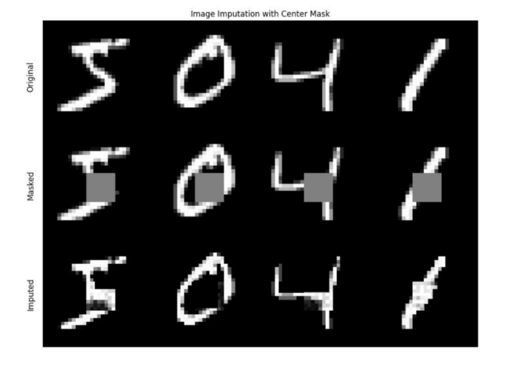
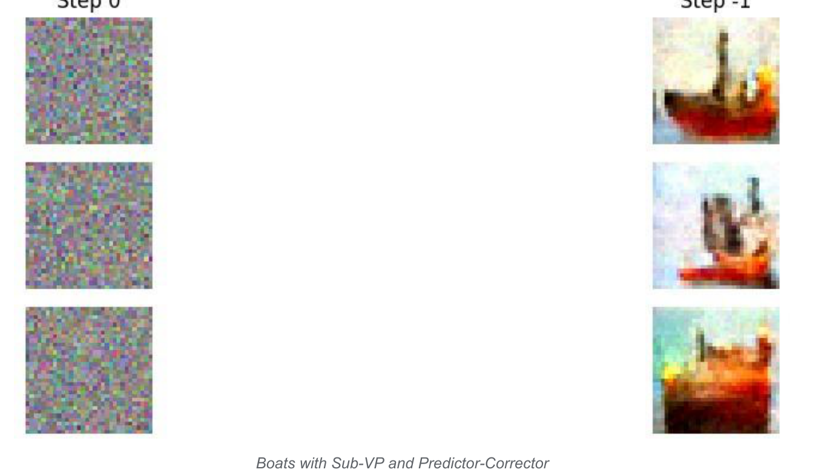

La versione in una frase della generazione di immagini con la diffusione è quasi troppo pulita: aggiungi rumore finché un'immagine diventa statico gaussiano, poi impari a invertire il processo. È una buona intuizione, ma nasconde la domanda di ingegneria che ha reso interessante questo progetto:

**Che cos'è esattamente "il processo" che invertiamo, e in quanti modi possiamo invertirlo?**

In questo progetto ho lavorato a un sistema modulare di generazione di immagini costruito attorno alla diffusione basata sullo score. L'obiettivo non era addestrare un enorme modello da produzione. Era costruire una piattaforma sperimentale pratica in cui si potessero cambiare il processo di diffusione, lo schedule del rumore, il sampler e la modalità di condizionamento senza riscrivere tutto il sistema.

Il sistema supportava dataset di immagini in scala di grigi e RGB, addestrava un modello di score in stile U-Net, generava campioni a partire dal rumore, li valutava con metriche standard e includeva modalità di generazione controllata come il condizionamento per classe e l'imputazione.

La parte che mi è piaciuta di più è che il progetto si è rifiutato di restare un singolo notebook. Il codice di diffusione diventa fuorviante molto in fretta quando SDE, scheduler, sampler e visualizzazione sono tutti intrecciati. Puoi ottenere una griglia di immagini, ma non riesci a capire se un miglioramento viene dal processo, dal metodo di integrazione, da un trucco di condizionamento o solo da un seed fortunato. Volevo che il pacchetto rendesse queste scelte abbastanza esplicite da far fallire un esperimento sbagliato almeno per un motivo rintracciabile.

## Lo score è la direzione per tornare ai dati

Il processo in avanti parte da un'immagine pulita x_0 e la corrompe progressivamente in x_t. Per un modello di diffusione a tempo continuo, questa corruzione si può descrivere come una SDE:

```text
dx = f(x, t) dt + g(t) dw
```

Qui f è il drift, g controlla l'intensità della diffusione e dw è rumore browniano. Il modello non deve imparare questo processo in avanti: lo scegliamo noi.

L'apprendimento avviene nella direzione inversa. Il modello impara una funzione di score:

```text
score(x_t, t) ~= gradient_x log p_t(x_t)
```

Intuitivamente, lo score punta verso le regioni in cui il campione rumoroso somiglia di più a qualcosa che potrebbe venire dalla distribuzione dei dati a quel livello di rumore. Il campionamento diventa allora navigazione numerica: si parte dal rumore, si chiede ripetutamente alla rete di score da che parte stanno i dati e si integra all'indietro.

Le due equazioni a cui tornavo sempre erano l'obiettivo di denoising score matching e la dinamica a tempo inverso. In termini di implementazione, il modello impara un campo vettoriale condizionato dal tempo:

```text
theta* = argmin_theta E_t,x0,z [
  lambda(t) || s_theta(x_t, t, y) - target_score(x_t, x0, t) ||_2^2
]

SDE inversa:
dx = [f(x,t) - g(t)^2 * s_theta(x,t)] dt + g(t) d_w_bar

ODE del flusso di probabilità:
dx = [f(x,t) - 0.5 * g(t)^2 * s_theta(x,t)] dt
```

Ecco perché l'astrazione dei sampler contava. Euler-Maruyama, Predictor-Corrector e Probability Flow ODE non sono varianti estetiche: sono modi diversi di usare lo stesso campo di score appreso.

Un ciclo di addestramento molto compresso è così:

```text
per ogni immagine x0 del dataset:
  campiona il tempo t
  campiona il rumore z
  costruisci l'immagine rumorosa xt con la SDE scelta
  chiedi a ScoreNet(xt, t, condizione) di prevedere la direzione dello score/rumore
  aggiorna la rete con una loss di denoising score matching
```

Questo è il nucleo concettuale. Il resto del progetto consiste nel rendere ogni blocco esplicito e sostituibile.

## Tre processi in avanti: VE, VP e Sub-VP

Il report implementava tre famiglie di processi di diffusione.

**Variance Exploding (VE)** si comporta come un processo di tipo moto browniano in cui la varianza cresce nel tempo. Non c'è un termine di drift che riporti indietro il campione: l'immagine si degrada perché la dispersione aumenta. VE è concettualmente diretto e utile per capire le SDE basate sullo score, ma la sua scala del rumore può crescere in modo aggressivo.

**Variance Preserving (VP)** aggiunge rumore mantenendo sotto controllo la varianza complessiva. Nel report del progetto, VP è descritto con un processo di tipo Ornstein-Uhlenbeck in cui sia il drift sia la diffusione dipendono dal tempo. L'immagine diventa progressivamente meno informativa, ma la distribuzione non esplode semplicemente verso l'esterno.

**Sub-Variance Preserving (Sub-VP)** modifica i coefficienti di VP in modo che il passaggio dall'immagine al rumore sia più graduale. È abbastanza vicino a VP da condividerne gran parte della struttura, ma abbastanza diverso da rendere i confronti interessanti.

Il senso pratico di implementarli tutti e tre era semplice: il processo di diffusione non è un dettaglio di sfondo. Cambia la geometria segnale-rumore vista durante l'addestramento e il comportamento numerico che si incontra durante il campionamento.

## Schedule del rumore: lineare contro coseno

Per VP e Sub-VP il sistema aveva bisogno di uno schedule che controllasse la velocità con cui si introduce il rumore. Ho implementato due opzioni:

- Uno schedule lineare, facile da ragionare, che cambia l'intensità del rumore in modo diretto.
- Uno schedule a coseno, che cambia in modo più morbido e spesso dà un percorso di degrado più naturale.

Lo schedule è una di quelle piccole scelte che in pratica diventano grandi. Se il modello vede troppo rumore troppo presto, l'apprendimento diventa inefficiente. Se la corruzione è troppo delicata, il modello potrebbe non imparare il regime ad alto rumore che serve all'inizio del campionamento. Un sistema di diffusione è meno un singolo algoritmo e più una catena di decisioni numeriche compatibili.

## La ScoreNet e perché una U-Net è la scelta naturale

Il modello di score usava un'architettura in stile U-Net con l'informazione temporale iniettata nella rete. Le U-Net funzionano bene qui perché il denoising è insieme locale e globale. La texture locale conta, ma il modello ha bisogno anche di contesto a lungo raggio per ricostruire una struttura coerente.

Il sistema usava embedding di Fourier per il tempo e, nei casi condizionati, l'informazione di classe veniva iniettata insieme all'embedding temporale. Quindi il modello imparava non solo:

```text
score(x_t, t)
```

ma, quando c'erano etichette:

```text
score(x_t, t | y)
```

Questa distinzione conta per la generazione controllata. Se y è un'etichetta di classe, come una cifra in MNIST, il campo di score cambia: il modello deve guidare il campione rumoroso verso immagini plausibili che appartengano anche a quella classe.

## Il campionamento è analisi numerica con la giacca dell'IA generativa

Una volta addestrata la rete di score, generare immagini diventa integrare. Si parte da rumore casuale e si procede all'indietro attraverso la dinamica inversa appresa. Il progetto implementava quattro sampler.

**Euler-Maruyama** è l'integratore stocastico di base. Combina un aggiornamento di tipo drift con un termine di rumore casuale. È semplice, veloce e un buon punto di riferimento, ma può richiedere molti passi per risultati di alta qualità.

**Predictor-Corrector** migliora il percorso inverso di base alternando due mosse: un passo predittore che fa avanzare la SDE inversa e un passo correttore che rifinisce il campione, spesso con aggiornamenti di tipo Langevin. Può produrre immagini migliori, ma i passi correttori in più aumentano il calcolo.

**Probability Flow ODE** trasforma il processo stocastico inverso in un'equazione differenziale ordinaria deterministica. Questo elimina la componente casuale durante il campionamento. Il risultato è spesso più deterministico e ripetibile; la diversità dipende più direttamente dal rumore iniziale.

**Exponential Integrator** usa funzioni esponenziali per trattare con più cura parti della dinamica inversa. Nell'implementazione può anche diventare deterministico quando il parametro di rumore è zero, avvicinandosi concettualmente alla Probability Flow ODE in quel regime. Il report segnala un vincolo di compatibilità importante: il processo VE non si usa con l'Exponential Integrator.

L'API di campionamento rendeva esplicito il compromesso:

```text
carica il modello addestrato
scegli il processo di diffusione
scegli un sampler compatibile
scegli il numero di passi e i parametri del sampler
genera un batch
mostra i campioni
```

Può sembrare normale modularità del software, ma per i modelli di diffusione è una cosa importante. Un sampler non è solo un dettaglio di implementazione: fa parte del comportamento del modello.

Uno dei controlli utili è stato misurare i tempi delle combinazioni di sampler invece di guardare solo le immagini finali. Il grafico qui sotto non è un benchmark universale: viene da un contesto sperimentale piccolo, quindi non interpreterei troppo i rapporti tra CPU e CUDA. Ma cattura la forma ingegneristica del problema: in questa configurazione Predictor-Corrector costa poco, Euler-Maruyama pesa di più e l'Exponential Integrator sta nel mezzo, comportandosi in modo diverso dai sampler stocastici.



Questo conta perché la scelta del sampler non riguarda solo la qualità visiva. Cambia la latenza, la ripetibilità e il numero di passi inversi che ci si può permettere. In un notebook didattico quel compromesso può restare nascosto. In un pacchetto riutilizzabile va messo in evidenza, perché il sampler "migliore" secondo una metrica può essere quello sbagliato per un flusso di lavoro interattivo.

## Condizionamento: spingere il campione verso una classe

Il sistema includeva la generazione condizionata per classe quando il dataset aveva etichette. Il modello può essere addestrato con embedding di classe, così la generazione può chiedere una categoria specifica:

```text
classe del campione = 3
parti da rumore gaussiano
esegui il processo inverso con score(x_t, t | classe=3)
restituisci immagini che dovrebbero somigliare a quella classe
```

Il report discute anche la classifier-free guidance. L'idea di base è imparare sia il comportamento condizionato sia quello non condizionato, e poi combinarli durante il campionamento:

```text
guided_score =
  unconditional_score
  + guidance_scale * (conditional_score - unconditional_score)
```

Aumentare la scala di guidance spinge di più verso la condizione di classe. Con troppa poca guidance il segnale di classe è debole; con troppa la diversità può risentirne. Una delle osservazioni utili del progetto è stata che l'intensità della guidance si può regolare nel tempo per bilanciare precisione visiva e varietà.

## Imputazione: la diffusione come modifica vincolata

L'imputazione era l'altro meccanismo di controllo. Invece di generare liberamente tutta l'immagine, il modello riceve un'immagine osservata in parte e una maschera binaria che indica quale regione manca. Il processo inverso è vincolato in modo che i pixel osservati restino fissi mentre la regione mancante viene rigenerata.

Il ciclo concettuale è:

```text
dati l'immagine originale x e la maschera M:
  tieni fissa la regione osservata
  diffondi o inizializza la regione mancante
  a ogni passo inverso:
    aggiorna solo la regione mascherata con il modello di score
    ripristina i pixel osservati dall'immagine nota
```

Questo trasforma la diffusione da "fammi un'immagine" a "completa questa immagine in modo coerente con il suo contesto". È una versione piccola dello stesso principio dietro molti flussi moderni di modifica delle immagini: il modello ha imparato una distribuzione sulle immagini e la maschera vincola dove può muoversi.



La demo di imputazione è piccola, ma è un buon test per capire se l'implementazione fa davvero generazione condizionata e non solo campionamento non condizionato con una maschera disegnata sopra. I pixel osservati vanno reimposti durante il processo inverso, altrimenti il campione si allontana dal contesto noto. Quel minuscolo dettaglio di implementazione è proprio il tipo di cosa che separa una spiegazione della diffusione da uno strumento di diffusione.

## Valutazione: non fidarti della griglia più bella

Il progetto includeva un modulo di metriche con tre misure comuni per la generazione di immagini.

**Bit per dimensione (BPD)** stima quanto bene il modello spiega la distribuzione dei dati, normalizzato per la dimensionalità dell'immagine.

**Frechet Inception Distance (FID)** confronta le statistiche delle immagini generate con quelle delle immagini reali in uno spazio di feature di Inception. Più basso è meglio, e la metrica si usa spesso come approssimazione grossolana del realismo visivo e della somiglianza tra distribuzioni.

**Inception Score (IS)** cerca di premiare immagini che siano sia classificabili sia diverse tra le classi.

Queste metriche sono imperfette, soprattutto su piccoli esperimenti accademici e dataset semplici. Includerle però conta, perché le griglie di immagini sono pericolosamente convincenti. Un campione generato può sembrare promettente mentre il modello sta collassando in diversità, oppure la metrica può sembrare accettabile mentre le immagini sono sfocate. L'approccio sano è guardare entrambe le cose.

## La forma del software

Il report descrive il sistema come un pacchetto e non come un singolo notebook. Il design principale separava:

- Definizioni dei processi di diffusione.
- Schedule del rumore.
- L'architettura ScoreNet.
- Routine di addestramento.
- Algoritmi di campionamento.
- Configurazione in YAML o dizionario.
- Strumenti di condizionamento e imputazione.
- Funzioni di valutazione.
- Notebook per addestramento, generazione, valutazione ed esempi avanzati.

L'orchestratore centrale era una classe sul modello di DiffusionExperiment che nascondeva i collegamenti all'utente. Un flusso tipico era:

```text
experiment = DiffusionExperiment(config)
experiment.train(dataset)
experiment.sample_and_plot(sampler="predictor_corrector")
experiment.evaluate(metrics=["bpd", "fid", "is"])
```

L'implementazione gestiva anche requisiti pratici: input in scala di grigi o RGB, normalizzazione in [-1, 1], formato dei tensori PyTorch, salvataggio e caricamento dei modelli, rilevamento di CPU/GPU, test dei componenti chiave e notebook che eseguono i flussi in ordine.

## Cosa hanno mostrato le demo

Il report descrive cinque notebook dimostrativi.

Il primo addestrava modelli sulla cifra 3 di MNIST, con le varianti VE, VP e Sub-VP e schedule lineari o a coseno. Il secondo confrontava i metodi di campionamento dei modelli addestrati: Euler-Maruyama, Predictor-Corrector, Probability Flow ODE ed Exponential Integrator. Il terzo passava alle immagini a colori con la classe barca di CIFAR-10. Il quarto valutava i campioni generati con BPD, FID e IS. Il quinto mostrava il condizionamento per classe e l'imputazione sulle cifre di MNIST.

I risultati erano volutamente presentati tenendo conto di un calcolo modesto. Addestrare da zero un modello basato su U-Net, con dimensioni ridotte e un numero limitato di passi, non può competere con i grandi sistemi di diffusione. Ma le immagini generate erano abbastanza coerenti da dimostrare che il sistema aveva imparato relazioni utili tra rumore, informazione di classe e forma visiva.



Non presenterei questi campioni come risultato artistico. Sono più utili come prova in fase di debug. Il lato sinistro è ancora rumore, il lato destro ha imparato la struttura della classe, e il centro della pipeline è dove di solito emergono piccoli errori di normalizzazione, di scala dei timestep o di compatibilità del sampler. Quando un'immagine generata sembra sbagliata, il bug raramente è solo "il modello è scarso": può essere il target dello score, la funzione di probabilità marginale, l'embedding del timestep, la varianza del passo inverso o il percorso di condizionamento.

Questo rende il progetto prezioso come piattaforma sperimentale: non "guarda, ho ricreato un modello di frontiera", ma "guarda, ogni pezzo importante della generazione di immagini basata sullo score è implementato, sostituibile e testabile".

## La lezione che ne ho tratto

I modelli di diffusione vengono spesso insegnati come se l'idea chiave fosse solo un denoising ripetuto. Costruirne uno rende più chiara la vera struttura. Un modello di diffusione è una pila:

```text
preprocessing dei dati
  -> SDE in avanti
  -> schedule del rumore
  -> rete di score
  -> obiettivo di addestramento
  -> sampler/integratore
  -> regola di condizionamento
  -> metrica di valutazione
```

Ogni livello si può cambiare. Ogni cambiamento ha conseguenze matematiche e software. VE, VP e Sub-VP definiscono geometrie del rumore diverse. Euler-Maruyama e Probability Flow ODE esprimono idee diverse sulla stocasticità durante il campionamento. Il condizionamento per classe e l'imputazione trasformano la generazione in una navigazione controllata nella distribuzione di immagini appresa.

La parte più utile del progetto è stata vedere come la matematica diventa ingegneria. Le equazioni ti dicono come dovrebbe essere il processo; il design del pacchetto decide se puoi davvero confrontare le varianti senza smontare il sistema.

È il tipo di progetto di IA generativa che mi piace: non solo una galleria di campioni, ma un piccolo laboratorio in cui i pezzi in movimento dell'algoritmo sono visibili.
