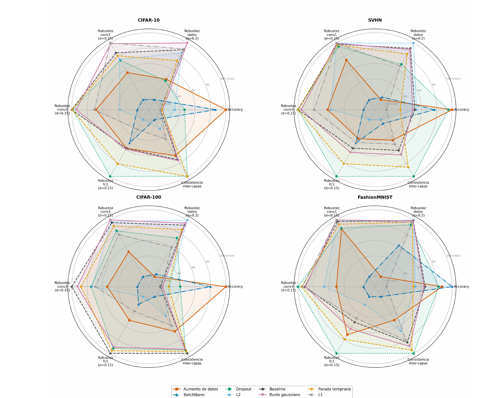

Quasi tutte le spiegazioni della regolarizzazione finiscono per ridursi a un solo grafico: la curva di addestramento continua a scendere, quella di validazione smette di migliorare e la distanza tra le due si chiama overfitting. È un'immagine utile, ma nasconde proprio l'oggetto che volevo studiare nella mia tesi triennale: la rappresentazione interna che la rete impara.

La domanda dietro la tesi era:

**Quando due CNN raggiungono un'accuratezza di validazione simile, organizzano l'informazione al loro interno nello stesso modo?**

La risposta è stata no. La regolarizzazione non cambiava solo il punteggio finale. Cambiava il modo in cui le attivazioni si distribuivano, si comprimevano, saturavano e reagivano alle perturbazioni. Il progetto è diventato un tentativo di rendere misurabile quella differenza.

Detto così sembra ovvio, ma non è da lì che sono partito. Il mio primo istinto era fare il confronto classico tra regolarizzatori, ordinarli per accuratezza di validazione e scrivere la discussione attorno a quella tabella. Più checkpoint ispezionavo, meno mi convinceva. Alcuni modelli erano accurati ma internamente "affilati". Altri non erano in cima alla classifica sulla validazione pulita, eppure resistevano molto meglio al rumore sui parametri. La tesi è diventata interessante solo quando ho smesso di trattare l'accuratezza come tutta la storia e ho cominciato a trattare la rete come un sistema con uno stato nascosto.

## L'impostazione: un modello volutamente noioso

Lo scopo del progetto non era costruire un classificatore allo stato dell'arte. Volevo una CNN abbastanza grande da andare in overfitting, ma abbastanza semplice da poter attribuire i cambi di comportamento al regolarizzatore e non a trucchi architetturali.

L'architettura è rimasta fissa in tutti gli esperimenti:

```text
immagine di input
  -> conv1: conv 3x3, 32 canali, ReLU, max-pool 2x2
  -> conv2: conv 3x3, 64 canali, ReLU, max-pool 2x2
  -> conv3: conv 3x3, 128 canali, ReLU, max-pool 2x2
  -> flatten
  -> fc1: 128 unità nascoste, ReLU
  -> fc2: logit delle classi
```

Per CIFAR-10 e SVHN questo significa che l'ultimo tensore convoluzionale è 4x4x128, che poi diventa un vettore di 2048 feature prima della rappresentazione densa a 128 dimensioni. Il modello di base arrivava a un'accuratezza di addestramento quasi perfetta su CIFAR-10 dopo 60 epoche, ed era esattamente quello che mi serviva: un modello con abbastanza capacità da memorizzare.

Ho confrontato sette strategie di regolarizzazione:

- Penalizzazione L1.
- Penalizzazione L2.
- Dropout.
- Early stopping.
- Rumore gaussiano iniettato durante l'addestramento.
- Data augmentation.
- Batch normalization.

I dataset erano CIFAR-10, SVHN, CIFAR-100 e FashionMNIST. Ognuno metteva sotto sforzo l'impostazione in modo diverso: CIFAR-10 era il dominio principale dell'analisi, SVHN era più omogeneo, CIFAR-100 metteva in luce i limiti di capacità e FashionMNIST produceva un regime vicino al tetto, in cui quasi tutti i metodi erano già forti.

## Perché l'accuratezza di validazione era una lente troppo piccola

L'accuratezza di validazione ti dice se il classificatore ha azzeccato le etichette. Non ti dice se la rete ha usato una rappresentazione compatta, caotica o collassata. Nella tesi ho trattato le attivazioni nascoste come oggetti empirici che si possono raccogliere e misurare.

Per ogni checkpoint addestrato caricavo il modello in modalità di valutazione e registravo dei forward hook su tre livelli:

- conv1, il primo estrattore di feature.
- conv3, la rappresentazione convoluzionale più profonda.
- fc1, lo spazio latente denso subito prima della classificazione.

La pipeline basata sugli hook era questa:

```text
per ogni dataset:
  per ogni metodo di regolarizzazione:
    per ogni valore dell'iperparametro:
      addestra per 60 epoche, salvando i checkpoint
      per le epoche selezionate:
        carica il checkpoint in modalità eval
        passa i dati di validazione nel modello
        cattura le attivazioni di conv1, conv3 e fc1
        converti le attivazioni in metriche confrontabili
```

Il dropout era disattivato in fase di estrazione e la batch normalization usava le statistiche apprese, quindi le attivazioni catturate riflettevano il modello addestrato così come lavora in inferenza.

La scelta di progetto chiave è stata usare gli stessi intervalli del modello di base per discretizzare le attivazioni. Dividevo l'intervallo di attivazione osservato in bin e rappresentavo ogni esempio con un vettore ordinato di identificativi di bin. Questo conservava l'identità dei neuroni meglio di un istogramma globale. Due stati che hanno semplicemente lo stesso numero di neuroni attivi non dovrebbero essere trattati automaticamente come lo stesso stato interno.

## Tre segnali interni

La tesi usava tre metriche principali sulle attivazioni.

**La percentuale di attivazioni uniche** misurava quanti stati discretizzati diversi comparivano in un passaggio di validazione:

```text
unique_pctg = numero di vettori di stato unici / numero di esempi di validazione
```

Se questo valore è troppo basso, molti input collassano nello stesso codice interno. Se è troppo alto, il modello potrebbe rappresentare ogni input in modo troppo specifico.

**L'entropia di Shannon** misurava quanto era concentrato l'istogramma delle attivazioni:

```text
H = - somma sui bin di p_i log(p_i)
```

Un'entropia bassa significa che le attivazioni si concentrano in pochi bin. Un'entropia alta significa che sono più distribuite.

**Il rapporto di dispersione** confrontava la deviazione standard delle attivazioni di un modello regolarizzato con quella del modello di base senza regolarizzazione:

```text
dispersion_ratio = std_attivazioni_regolarizzato / std_attivazioni_base
```

È utile perché la dispersione grezza dipende dal livello e dal dataset. Un rapporto minore di uno significa che il regolarizzatore ha compresso la distribuzione delle attivazioni rispetto al modello di base.

Queste metriche non hanno niente di magico. Sono volutamente semplici. Il loro valore è che permettono di parlare della regolarizzazione come geometria delle rappresentazioni, e non solo come un intervento sul punteggio di validazione.

## Cosa dicevano prima di tutto i risultati di accuratezza

I risultati esterni non sorprendevano a grandi linee, ma erano importanti come punto di riferimento. Data augmentation e batch normalization davano i miglioramenti più forti di accuratezza di validazione in tutti i domini valutati. Dropout e L2 stavano in genere a metà. Rumore gaussiano, early stopping e L1 erano più deboli, a volte appena migliori del modello di base.

Su CIFAR-10, per esempio, i metodi migliori del report erano:

| Metodo | Accuratezza di validazione | Stati unici in fc1 | Entropia in fc1 | Rapporto di dispersione in fc1 |
| --- | ---: | ---: | ---: | ---: |
| Data augmentation | 0.785 | 89.22% | 1.78 | 0.46 |
| BatchNorm | 0.770 | 84.30% | 1.53 | 0.41 |
| Dropout | 0.727 | 37.23% | 1.17 | 0.29 |
| L2 | 0.714 | 97.93% | 2.09 | 0.57 |
| Modello di base | 0.694 | 99.98% | 2.87 | 1.06 |

Anche il divario di generalizzazione raccontava qualcosa di importante. Su CIFAR-10 il modello di base, L2 e il rumore gaussiano arrivavano a un'accuratezza di addestramento vicina a 1.0 mantenendo un divario di circa 0.30. La data augmentation riduceva quel divario a circa 0.09. La batch normalization aveva ancora un divario più ampio, intorno a 0.23, il che suggerisce che parte del suo valore venisse dallo stabilizzare l'ottimizzazione più che dall'impedire la memorizzazione.

Ma la parte più interessante era cosa succedeva leggendo insieme accuratezza e struttura interna.

## La zona intermedia

Lo schema principale era che i modelli forti tendevano a stare in una fascia intermedia di diversità interna, soprattutto in fc1. Troppo poca diversità sembrava compressione o sottoutilizzo della rappresentazione. Troppa diversità sembrava memorizzazione o specializzazione rumorosa.

Per questo il modello di base non era solo "peggiore perché aveva meno accuratezza di validazione". Produceva anche percentuali di stati unici quasi massime ed entropia alta in fc1 su CIFAR-10. Usava molti stati interni distinti, ma quella diversità non si traduceva in una generalizzazione migliore. Al contrario, data augmentation e batch normalization comprimevano la distribuzione delle attivazioni pur conservando abbastanza varietà da classificare bene.

Il dropout era particolarmente interessante. Non vinceva la classifica sulla validazione pulita, ma produceva una rappresentazione fc1 molto più compressa e più avanti mostrava una forte robustezza sui parametri. Questa distinzione conta: se leggi solo l'accuratezza, il dropout sembra semplicemente discreto. Se ispezioni la geometria interna e il comportamento sotto perturbazione, diventa un regolarizzatore qualitativamente diverso.

## Conta anche il tempo

La tesi non si limitava a ispezionare l'ultimo checkpoint. Seguiva l'evoluzione degli stati interni nel corso di 60 epoche. In molti casi l'accuratezza di validazione saliva in fretta nelle prime 10 epoche e poi si stabilizzava, mentre la diversità interna continuava a crescere.

SVHN lo rendeva particolarmente visibile. Il modello di base e quello con rumore gaussiano arrivavano presto a circa il 90% di accuratezza di validazione, ma le loro percentuali di stati unici continuavano a crescere fino alla fine dell'addestramento. La data augmentation cresceva più lentamente e finiva con un divario di generalizzazione molto più piccolo.

È un'idea diagnostica utile: oltre un certo punto, continuare ad addestrare può rendere la rappresentazione sempre più complicata senza miglioramenti significativi in validazione. La rete continua a cambiare al suo interno, ma non necessariamente in un modo che aiuti a generalizzare.

## La robustezza cambiava la classifica

La tesi includeva due esperimenti di perturbazione.

Nel primo ho aggiunto rumore gaussiano alle immagini di validazione lasciando fissi i pesi del modello. Questo misurava il degrado con input rumorosi. Qui la storia non era "il miglior modello sui dati puliti è il più robusto". Anzi, data augmentation e BatchNorm, forti nella validazione pulita, peggioravano bruscamente con rumore gaussiano intenso a livello di pixel. Su CIFAR-10, con rumore sull'input sigma = 0.2, la data augmentation conservava circa il 49.7% della sua accuratezza pulita e BatchNorm circa il 34.9%, mentre il modello di base e L2 ne conservavano circa il 71.3% e il 69.0%.

Questo non significa che il modello di base sia migliore. Significa che la robustezza dipende dalla perturbazione. La data augmentation era stata addestrata con invarianze a ritaglio e ribaltamento orizzontale, non con rumore gaussiano arbitrario sui pixel. Un metodo può migliorare la generalizzazione sui dati puliti e restare fragile davanti a un'altra famiglia di corruzioni.

Nel secondo ho aggiunto rumore gaussiano direttamente ai pesi di conv1, conv3 e fc1. Era un'approssimazione pratica della geometria del minimo appreso. Se una piccola perturbazione dei parametri distrugge l'accuratezza, probabilmente il modello si trova in una regione più ripida della superficie di loss.

È qui che il dropout si distingueva. Con rumore sui pesi sigma = 0.15, il dropout aveva una ritenzione costantemente alta tra livelli e dataset. Su CIFAR-10 conservava l'83.1% in conv1, il 77.5% in conv3 e l'86.1% in fc1. BatchNorm, nonostante le ottime prestazioni sui dati puliti, crollava di più nei livelli convoluzionali, con ritenzioni su CIFAR-10 del 51.2% in conv1 e del 42.0% in conv3.

Il grafico radar qui sotto è la versione compatta di questa tensione. Ogni asse è normalizzato all'interno del dataset, quindi non va letto come una scala di misura assoluta. È una vista di profilo: accuratezza di validazione, robustezza al rumore sui dati, robustezza al rumore sui pesi in conv1/conv3/fc1 e coerenza tra livelli. La parte utile non è che incoroni un vincitore. La parte utile è che rende visibile la forma di ogni regolarizzatore.

Il profilo che ho usato si può pensare come un piccolo vettore multiobiettivo per regolarizzatore e dataset:

```text
v_metodo,dataset =
  [
    val_acc,
    retention_data_noise_sigma_0.20,
    retention_weight_noise_conv1_sigma_0.15,
    retention_weight_noise_conv3_sigma_0.15,
    retention_weight_noise_fc1_sigma_0.15,
    inter_layer_consistency
  ]

normalized_axis_value =
  15 + 85 * (x - min_axis) / (max_axis - min_axis)
```

Il minimo a 15 mantiene visibile un metodo debole senza fingere che valga zero, e la normalizzazione min-max per asse evita che il radar mescoli percentuali grezze con misure di robustezza eterogenee.



Il grafico rendeva difficile ignorare una cosa: nessun metodo riempie la stella. La data augmentation spinge molto l'accuratezza pulita, soprattutto nei dataset di immagini in cui l'augmentation corrisponde alle invarianze del compito, ma non domina tutti gli assi di robustezza. Il dropout è meno brillante nella tabella di accuratezza, eppure la sua impronta sotto rumore sui pesi è costantemente ampia. BatchNorm ha un profilo forte in diversi domini ma può diventare fragile quando la perturbazione colpisce i parametri convoluzionali. L2 mantiene spesso uno spazio di stati interni ampio, che in termini di entropia può sembrare sano ma non significa automaticamente una generalizzazione migliore.

Mi piace questa visualizzazione perché impedisce la frase pigra "il regolarizzatore X è il migliore". Costringe alla domanda successiva: migliore su quale asse, su quale dataset e contro quale perturbazione?

La lezione non è che BatchNorm sia cattiva. La lezione è che lo stesso metodo può essere eccellente per l'ottimizzazione e fragile sotto perturbazione dei parametri. Quella differenza è invisibile se l'unica colonna del foglio di calcolo è l'accuratezza di validazione.

## La conclusione pratica

Alla fine del progetto non pensavo più alla regolarizzazione come a una classifica di tecniche. La pensavo come un insieme di bias con modi di fallire diversi.

La data augmentation era la scelta migliore quando la priorità era la prestazione in validazione su immagini pulite. Il dropout era il candidato più forte quando contava la stabilità dei parametri. L2 e perfino il modello di base potevano sembrare relativamente resistenti al rumore stocastico sull'input, anche se sacrificavano la prestazione sui dati puliti. BatchNorm era potente ma "affilata" nell'estrattore di feature convoluzionale.

Questa risposta condizionale è meno ordinata di una classifica, ma è più vicina a come userei davvero i risultati. Se addestrassi un piccolo modello di visione per un contesto in cui la distribuzione degli input è pulita e l'augmentation cattura le invarianze attese, comincerei dall'augmentation. Se mi interessassero compressione, pruning, pesi rumorosi in produzione o piccole perturbazioni dell'hardware, riguarderei il dropout e non lo scarterei solo perché ha perso la gara sulla validazione pulita. Se un modello mostrasse entropia alta, alta percentuale di stati unici e un divario ampio, lo tratterei come un campanello d'allarme e non, per default, come una "rappresentazione ricca".

Così la risposta della tesi a "qual è il regolarizzatore migliore?" era volutamente condizionale:

```text
se la priorità è l'accuratezza sui dati puliti:
  di solito la data augmentation è la più forte
se la priorità è la piattezza / robustezza dei parametri:
  il dropout è più interessante
se la priorità è resistere al rumore sull'input:
  analizza con attenzione L2 e i comportamenti simili al modello di base
se il dataset è troppo facile o troppo difficile per l'architettura:
  l'accuratezza può nascondere l'effetto interno del regolarizzatore
```

Il risultato principale non era un nuovo regolarizzatore. Era un argomento di misura: le metriche sulle attivazioni interne possono fare da diagnostica per la sotto- e la sovra-regolarizzazione. Non sostituiscono l'accuratezza di validazione, ma spiegano cose che l'accuratezza schiaccia.

## Cosa estenderei

La prima estensione sarebbe ripetere il protocollo su architetture più profonde come ResNet-18 o VGG-16. La seconda sarebbe studiare combinazioni di regolarizzatori, visto che i modelli reali usano raramente un solo metodo alla volta. La terza sarebbe confrontare la similarità delle rappresentazioni con CKA, per verificare se due regolarizzatori con metriche diverse imparano davvero spazi strutturalmente simili.

L'idea a più lungo termine è uno strumento diagnostico automatico: addestri un modello, estrai le attivazioni, calcoli le curve di entropia, dispersione e stati unici e segnali le rappresentazioni che sembrano collassate o troppo disperse, prima di affidarti solo al comportamento tardivo in validazione.

Per me il valore della tesi è stato questo. Ha trasformato la CNN da una scatola nera che restituisce un numero di accuratezza in un sistema dinamico i cui stati interni si possono misurare, confrontare e mettere in discussione.
